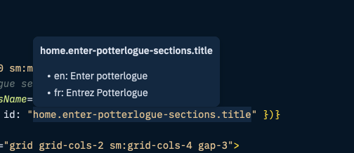

# zed-i18n

A Zed extension that shows your translations on hover.
Hover over a translation key like `t("app.welcome")` and a popup shows its text in every language your app supports.

> I built this while learning Rust, as a way to learn by building something I'd actually use.



It's built as a **language server (LSP)**: the standard way editors ask a helper program for things like hover popups.

## What's in this repo

```
zed_i18n/
  src/              the language server (a normal Rust program)
    main.rs         LSP wiring: startup, open/change/close, hover
    cursor.rs       finds the key under the cursor and checks it's inside a translation call
    locales.rs      loads the locale JSON files and turns nested JSON into a simple key → text list
  extension/        the Zed extension (compiled to WebAssembly by Zed)
    extension.toml  extension info and which languages to attach the server to
    src/lib.rs      tells Zed how to find and start the server
  test-fixtures/    sample locale files used by the tests
```

Zed extensions run in a sandbox and can't read files or draw their own UI, so the work is split in two:
- **the server** does the real work: finds the locale files, loads them, and answers hover requests
- **the extension** only tells Zed where the server is and which files to use it for

## How it works

1. When Zed starts the server, it looks in your project for the first locale folder that exists:
   `public/locales`, `src/locales`, `src/i18n`, `src/assets/i18n`, `translations`, `locales`, `i18n`, `lang`
2. It loads every `.json` file in that folder. The filename is the language (`en.json` → `en`).
   Nested and flat keys both work: `{ "app": { "welcome": "Hi" } }` and `{ "app.welcome": "Hi" }` give the same key.
3. When you hover, it finds the key under the cursor, checks that it's inside a translation call,
   and shows the key's text in every language, sorted.

### Recognised translation calls

| Library | Example |
|---|---|
| i18next / react-i18next / next-intl | `t("key")`, `i18n.t("key")`, `<Trans i18nKey="key">` |
| react-intl | `formatMessage({ id: "key" })`, `<FormattedMessage id="key">` |
| vue-i18n | `$t('key')`, `$tc('key')`, `v-t="'key'"` |
| ember-intl | `{{t "key"}}`, `(t "key")` |
| ngx-translate / Transloco | `'key' \| translate`, `translate.instant('key')` |
| svelte-i18n | `$_('key')` |

## Install (local)

You need [Zed](https://zed.dev) and Rust installed via [rustup](https://rustup.rs).

1. Clone the repo and go into it:
   ```
   git clone https://github.com/Benneee/zed_i18n.git
   cd zed_i18n
   ```
2. Install the server:
   ```
   cargo install --path .
   ```
   Check it with `which zed_i18n`.
3. In Zed, open the command palette (`Cmd + Shift + P`), run **zed: install dev extension**,
   and pick the `extension/` folder. It shows up in your extensions list as **i18n LSP**.
4. Open a project with a locale folder and hover over a translation key.

If Zed can't find `zed_i18n`, open the project from a terminal with `zed .` so Zed picks up your `PATH`.
Server logs are in the command palette under "language server logs".

## Tests

```
cargo test
```

## Limitations

- JSON locale files only, one file per language (`locales/en.json`). Namespaced folders like `locales/en/common.json` aren't supported.
- A call split across several lines isn't detected.
- Dynamic keys like `` t(`app.${x}`) `` can't be resolved.
- Locale files are read once when the server starts. After editing them, run **editor: restart language server** from the command palette.

## Why it isn't on Zed's extension registry

Zed only accepts one extension per use case, and similar extensions already exist:
[Intl Lens](https://github.com/nguyenphutrong/i18nlens) and [i18n Lens](https://github.com/yizixu/zed-i18n-lens).
This repo is a personal project and a learning exercise. Feel free to use it locally.

## License

MIT. See [LICENSE](LICENSE)
